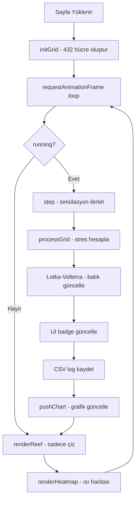

# 🪸 Coral Reef Stress & Bleaching Monitor — Proje Dokümantasyonu

> **Dosya:** `index.html` (+ `i18n.js`)  
> **Teknolojiler:** HTML5, CSS3, JavaScript (vanilla), Chart.js 4.4.1, Google Fonts (IBM Plex Serif / Sans / Mono)  
> **Toplam Satır:** ~3430  
> **Tek dosya uygulaması** — harici bağımlılık yok (CDN hariç)  
> **Ek Dosyalar:** `i18n.js`, `coral_simulation_dataset.csv`, `pacific_map_bg.png`, `Corauxx.webp`, `README.md`, `README.tr.md`

---

## 1. Projeye Genel Bakış

Bu uygulama, mercan resiflerinin iklim değişikliği altındaki davranışını simüle eden interaktif bir ekolojik modelleme aracıdır. 2013–2100 yılları arasını kapsayan simülasyon, gerçek NOAA verilerine dayanır ve IPCC SSP2-4.5 senaryosunu kullanarak geleceğe projeksiyon yapar.

**Ana Özellikler:**
- 24×18 hücrelik grid tabanlı mercan resif haritası
- Gerçek zamanlı IDW (Inverse Distance Weighting) interpolasyonlu ısı haritası
- Lotka-Volterra av-avcı balık popülasyonu dinamikleri
- Kapsamlı iklim politikası kontrol paneli (14 kaldıraç)
- Türkçe / İngilizce dil seçeneği (`i18n.js`)
- İlk girişte karşılama ekranı + 6 adımlık kısa tanıtım turu
- Deniz Koruma Alanları (MPA) çizim sistemi
- Erken Uyarı Sistemi (EWS)
- CSV veri dışa aktarma (canlı satır sayacı)
- Bölge karşılaştırma modu
- 4 farklı ısı haritası görünümü (SST, Coral, Prey, Predator)
- **5 Pasifik bölgesi** (American Samoa, Main Hawaiian Islands, Mariana Archipelago, Northwestern Hawaiian Islands, Pacific Remote Island Areas)
- **Mini Dünya Haritası** — Uydu arka planlı, tıklanabilir bölge noktaları
- **2100 Projeksiyon Tahmini** — Canlı hesaplanan sağlık yüzdesi
- **Simülasyon Sonu Değerlendirmesi** — Türkçe puan ve sonuç ekranı
- **Anlık Analiz Paneli** — En yüksek ağarma yüzdesi, kritik yıl ve korunan alan oranını canlı izleyen panel
- **Senaryo Seçim Butonları** — Hızlı başlangıç için 3 hazır politika senaryosu (BAU, Optimal, MPA Only)
- **Gerçek NOAA Veri Entegrasyonu** — Healthy Colonies grafiği üzerinde altın yıldız şeklinde gösterilen gözlemlenmiş NOAA verileri
- **Veri Kaynağı Footer** — NOAA NCRMP · NOAA NCEI · IPCC SSP2-4.5

---

## 2. Dosya Yapısı (Tek HTML İçinde)

```
coral_simulation/
├── index.html                   # Ana simülasyon (HTML/CSS/JS)
├── i18n.js                      # Dil sözlüğü (TR/EN) ve dil değiştirme
├── coral_simulation_dataset.csv # NOAA kaynak veri seti (21 kayıt, 5 bölge)
├── pacific_map_bg.png           # Mini harita uydu arka plan görseli
├── PROJECT_DOCUMENTATION.md     # Bu dosya
├── README.md                    # İngilizce README (ana sayfa)
├── README.tr.md                 # Türkçe kullanıcı kılavuzu
└── docs/                        # Ekran görüntüleri, sosyal medya önizlemesi

index.html iç yapısı:
├── <head>
│   ├── Meta bilgileri & SEO
│   ├── Google Fonts (IBM Plex) import + ilk boyamadan önce tema seçimi
│   ├── Chart.js CDN import
│   └── <style> — Tüm CSS kuralları (~780 satır)
├── <body>
│   ├── .water-fx — Arka plan su efekti
│   ├── .app — Ana konteyner
│   │   ├── .left-panel — Sol panel (kontroller + harita)
│   │   │   ├── h1 + subtitle — Başlık
│   │   │   ├── Flex row: .badges + #stat-cards | #mini-map-wrap (sağ)
│   │   │   ├── .controls — Temel simülasyon kontrolleri
│   │   │   ├── .policy-panel — Politika kontrol paneli
│   │   │   └── .grid-container — Harita canvas + timeline
│   │   └── .right-panel — Sağ panel (grafikler + ısı haritası)
│   │       ├── #analysis-panel — Anlık analiz paneli (HTML)
│   │       ├── .charts-stack — 4 adet Chart.js grafiği (tooltip'li)
│   │       └── .heatmap-overlay — Isı haritası modu
│   ├── Info Button (?) — Sağ alt köşe
│   ├── Info Panel — Bilgi modalı (Türkçe)
│   └── <footer> — Veri kaynağı + GitHub bağlantısı
└── <script> — Tüm JavaScript (~2250 satır)
```

---

## 3. CSS Tasarım Sistemi

### 3.1 Renk Paleti (tema token'ları)
Tüm arayüz renkleri `:root` üzerindeki CSS değişkenlerinden gelir; `<html data-theme="light|dark">` ile değişir.
Grafikler `themeColor()` ile aynı değişkenleri okur (`applyChartTheme()`).

| Token | Aydınlık · Lagün | Karanlık · Derin Okyanus | Kullanım |
|-------|------------------|--------------------------|----------|
| `--bg` | `#F3F5F4` | `#0B1619` | Sayfa zemini |
| `--surface` | `#FFFFFF` | `#102024` | Paneller |
| `--line` | `#D3DCDB` | `#24383E` | İnce çizgiler |
| `--text` / `--title` | `#1C343C` / `#0E242C` | `#D9D6CD` / `#ECE8DE` | Metin |
| `--muted` | `#5A6F78` | `#8D9D9F` | İkincil metin, etiketler |
| `--sea` | `#0F5464` | `#6FB3AA` | Düğmeler, etkin durum |
| `--coral` | `#C4553C` | `#E8806A` | Yalnızca mercan verisi |
| `--good` / `--warn` / `--bad` | `#2E8C72` / `#A86F12` / `#B5402F` | `#5DB896` / `#D9A54A` / `#E06A55` | Durum renkleri |

Resif haritası ve ısı haritası `--map-*` değişkenleriyle her iki temada koyu kalır.

### 3.2 Ana CSS Sınıfları
- **`.app`** — Dikey flex konteyner, `min-height: 100vh`
- **`.left-panel`** / **`.right-panel`** — Tam genişlik, dikey yığın
- **`.controls`** — Flex-wrap kontrol grubu, `gap: 10px`
- **`.badge`** — Gradient arka planlı durum rozetleri
- **`.btn`** — Hover efektli butonlar, `.active` durumu ile mavi gradient
- **`.grid-container`** — Sabit 500px yükseklik, siyah arka plan
- **`.policy-panel`** — Açılır-kapanır politika paneli
- **`.charts-stack`** — 240px yükseklikte yatay grafik sırası
- **`.heatmap-overlay`** — 480px yükseklikte ısı haritası modu
- **`.chart-card`** — Her grafik için kart, başlık + canvas

### 3.3 Animasyonlar
- **`projPulse`** — "PROJECTED" etiketi için nabız efekti
- **`fadeInUp`** — Simülasyon tamamlandı banner'ı için giriş animasyonu

---

## 4. Veri Katmanı

### 4.1 Gerçek Veri Seti (`DATA` + `coral_simulation_dataset.csv`)
NOAA NCRMP'den alınan **21 kayıt** (5 bölge, 2013–2023):

| Bölge | Yıl Aralığı | Kayıt Sayısı | Toplam Koloni |
|-------|------------|-------------|---------------|
| American Samoa | 2015–2023 | 4 | 85,436 |
| Main Hawaiian Islands | 2013–2019 | 3 | 47,641 |
| Mariana Archipelago | 2014–2022 | 3 | 72,981 |
| Northwestern Hawaiian Islands | 2014–2017 | 4 | 19,352 |
| Pacific Remote Island Areas | 2014–2023 | 7 | 43,195 |

CSV dosyası 17 sütun içerir: year, region, total_colonies, healthy_count, bleached_count, dead_count, avg_old_dead_pct, avg_recent_dead_pct, avg_colony_length_cm, latitude, longitude, healthy_pct, bleached_pct, dead_pct, global_bleaching_avg_pct, global_bleaching_records, coral_health_index

### 4.2 Bölge Koordinatları (`REGION_COORDS`)
NOAA NCRMP verisinden alınan gerçek koordinatlar:

| Bölge | Enlem | Boylam |
|-------|-------|--------|
| American Samoa | -14.28° | -169.47° |
| Main Hawaiian Islands | 20.79° | -156.99° |
| Mariana Archipelago | 16.53° | 145.38° |
| Northwestern Hawaiian Islands | 25.90° | -171.92° |
| Pacific Remote Island Areas | 5.09° | -164.03° |

### 4.3 Projeksiyon Çapaları (`PROJ_ANCHORS`)
IPCC SSP2-4.5 senaryosuna dayanan 9 veri noktası (2024–2100). Sıcaklık, 2013–2023 ortalamasına göre tropikal SST anomalisidir:

```
2024: +0.1°C,  sağlık: 0.68
2050: +0.8°C,  sağlık: 0.38
2100: +1.75°C, sağlık: 0.04
```

Emisyon kaydırıcılarının etkisi `emissionRamp(year)` ile 2024–2060 arasında kademeli devreye girer (iklim gecikmesi).

### 4.3.1 Bölgesel İklim (`REGION_CLIMATE`)
Her bölge için yıllık ortalama SST (`mean`), mevsimsel yarı genlik (`amp`) ve en sıcak ay (`peakMonth`).
MMM = mean + amp. Sıcaklık kaydırıcısı seçili bölgenin yıllık ortalamasını temsil eder ve bölge seçildiğinde bu değere ayarlanır.

### 4.4 Bölgeye Özel Ağartma Olayları (`REGION_EVENTS`)
Spike değerleri, mevsimsel döngünün üstündeki tepe SST anomalisidir ve her bölgenin sıcak mevsiminde (±6 ay üçgen profil) zirve yapar.
Etiketler `eventLabel(year)` ile üretilir (2014–2017: 3. küresel olay, 2023–2025: 4. küresel olay, diğerleri "Marine Heatwave").

| Bölge | Gözlenen sıcak dalgalar (tepe SST anomalisi) |
|-------|-----------------------------------------------|
| American Samoa | 2015 (+0.7°C), 2016 (+1.1°C), 2017 (+0.6°C), 2020 (+0.8°C), 2024 (+1.0°C) |
| Main Hawaiian Islands | 2014 (+0.9°C), 2015 (+1.6°C, Batı Hawaii'de ağır ölüm), 2019 (+1.0°C) |
| Mariana Archipelago | 2013 (+0.8°C), 2014 (+1.0°C), 2016 (+0.8°C), 2017 (+1.0°C), 2024 (+1.0°C) |
| Northwestern Hawaiian Islands | 2014 (+1.4°C, Lisianski/Pearl & Hermes), 2015 (+0.6°C), 2017 (+0.9°C), 2019 (+0.8°C) |
| Pacific Remote Island Areas | 2015 (+0.8°C), 2016 (+1.0°C, 2015–16 El Niño), 2024 (+1.0°C) |

Şiddetler, `healthy_pct` NCRMP ölçümlerine karşı kalibre edilmiştir (2013–2023 RMSE 13.0 → 5.2, 6 tohum ortalaması).

### 4.5 Koloni İstatistikleri
NOAA ile karşılaştırma için koloniler sağlıklı / ağarmış / ölü olarak sayılır (çıplak zemin hariç). Yeniden büyüyen
(`regrowing`) bir alan, stresi `ESTABLISHED_STRESS` (0.55) altına inene kadar — yani yeni koloniler yerleşene kadar,
yaklaşık 5 yıl — ölü koloni sayılır; çıplak zemin de ancak bu eşikte koloniye dönüşür. Restorasyonla dikilen koloniler
doğrudan bu eşikte başlar.

2026–2099 arası için her sıfırlamada rastgele sıcak dalgalar (`futureEvents`, yılda ~%20 olasılık, +0.5–1.2°C) üretilir.

---

## 5. Simülasyon Motoru

### 5.1 Grid Yapısı
- **Boyut:** 24 sütun × 18 satır = 432 hücre
- **Her hücre:** `{ state, stressLevel, localTemp, dhw, hs, regrowing }`
  - `hs`: son 7 tick'in HotSpot katkıları (12 haftalık DHW halka tamponu)
  - `regrowing`: ölmüş ve larva yerleşimiyle yeniden büyüyen hücre
  - `substrate`: henüz koloni olmayan çıplak zemin; üzerine mercan yerleşince (veya restorasyonla) koloniye dönüşür. Koloni istatistiklerine dahil edilmez.
- **Durumlar:** HEALTHY → STRESSED → BLEACHED → DEAD → RECOVERING

### 5.2 Durum Geçiş Eşikleri
```
stressLevel ≤ 0.25  →  HEALTHY
stressLevel ≤ 0.55  →  STRESSED
stressLevel ≤ 0.82  →  BLEACHED (veya RECOVERING)
stressLevel > 0.82  →  DEAD
```

### 5.3 Sıcaklık Hesaplama Zinciri
```
anomaly    = sliderTemp - REGION_CLIMATE[region].mean
projDelta  = (PROJ_ANCHORS(year) + emissionEffect × emissionRamp(year)) × policyMult
regionTemp = mean + anomaly + projDelta + cos(2π(month - peakMonth)/12) × amp
finalTemp  = regionTemp + eventSpike
localTemp  = finalTemp + SimplexNoise(kayan) × 0.8 + currentEffects (±0.5°C)
```

### 5.4 Stres Yayılım Modeli (`processGrid`)
Her tick'te her hücre için:
1. **Lokal sıcaklık** hesaplanır (zamanla kayan gürültü + okyanus akıntıları)
2. **DHW** güncellenir: `HotSpot = localTemp − MMM`, ≥1°C ise × 1.74 hafta, 7 tick'lik pencerede toplanır
3. **Stres çarpanları** belirlenir (turizm, MPA, EWS, GEF fon, Recovery Speed)
4. `DHW > eşik − 1` ise stres `(DHW − eşik + 1) × 0.0045` oranında artar; ağarmış komşular hastalık stresi ekler
5. `DHW < 1` ise yaşayan koloniler `0.008`/tick ile toparlanır, ölü hücreler sağlıklı komşu başına `0.0003`/tick ile yeniden büyür

### 5.5 Okyanus Akıntıları
3 akıntı merkezi sinüs/kosinüs ile hareket eder:
- 2 akıntı ısıtıcı (+0.5°C etki, 8 hücre yarıçap)
- 1 akıntı soğutucu (-0.5°C etki)

### 5.6 Lotka-Volterra Balık Dinamikleri
```javascript
K = max(5, 100 × effectiveKIndex)   // Taşıma kapasitesi
dPrey = r×prey×(1 - prey/K) - α×prey×predator
dPred = β×prey×predator - δ×predator
// r=0.08, α=0.005, β=0.003, δ=0.04
```
Balıkçılık kotası `dPrey` üzerine ek etki yapar.

### 5.7 Restorasyon Mekanizması
```javascript
restorationChance = (budget/100) × 0.003 × (1 + gefFund/100)
// MPA içindeyse ×2 çarpan
// Başarılı ise: DEAD → RECOVERING (stress=0.78, regrowing) — dikilen fragmanlar yıllar içinde büyür
```

---

## 6. Render Sistemi

### 6.1 Ana Harita (`renderReef`)
- **IDW Interpolasyon:** 0.25× çözünürlükte off-screen canvas
- **Simplex Noise türbülansı:** Organik, akan görünüm
- **5×5 komşuluk** IDW ağırlıklama
- DPR (Device Pixel Ratio) desteği

### 6.2 Katmanlar (üstten alta)
1. IDW interpolasyonlu mercan sağlık haritası
2. Renk çubuğu (sağ kenar)
3. MPA koruma alanları (teal overlay + 🛡️ ikon)
4. EWS otomatik koruma (cyan overlay)
5. Çizim önizleme dikdörtgeni (beyaz kesikli)
6. Silme hover efekti (kırmızı + 🗑️)
7. Tarih/bölge/SST metin overlay'i
8. Politika uyarı çubuğu (kırmızı)
9. Duraklatma overlay'i
10. Ağartma olay etiketi

### 6.3 Isı Haritası Modu (`renderHeatmap`)
5 katman, hepsi sabit ölçekli (`HEATMAP_CONFIG`: palet, renk çubuğu işaretleri, eksen etiketi):

| Mod | Palet | Aralık / İşaretler |
|-----|-------|--------|
| SST | Mor→Mavi→Yeşil→Sarı→Kırmızı→Beyaz | Bölge MMM'sinin ±3°C'si; MMM işaretli |
| DHW | Lacivert→Yeşil→Sarı→Turuncu→Kırmızı→Bordo | 0–16 °C-hafta; 4 (ağarma) ve 8 (ölüm riski) işaretli |
| Coral | Mavi→Teal→Sarı→Kırmızı→Siyah | Stres 0–1; durak noktaları durum eşiklerinde (0.25/0.55/0.82) |
| Prey | Siyah→Lacivert→Mavi→Cyan | Mutlak 0–1 (karekök ile görünürlük) |
| Predator | Siyah→Mor→Leylak→Pembe | Mutlak 0–1 (karekök ile görünürlük) |

- Piksel görüntüsü yalnızca tick, katman, boyut, dil veya bölge değişince yeniden hesaplanır (`hmCacheKey`);
  üst bilgi, MPA çerçeveleri ve fare/dokunma ile değer okuma her karede önbellekteki görüntünün üstüne çizilir.
- Türbülans 4–6 px ile sınırlıdır; lekeler hücrelerle örtüşür.

### 6.4 Grafikler (Chart.js)
4 zaman serisi grafiği ortak sayısal yıl eksenini (`setTimeAxisEnd`) paylaşır ve 2013'ten itibaren tüm geçmişi tutar
(her `LOG_INTERVAL` = 3 tick'te bir nokta; ileri sarma sırasında da kaydedilir, yalnızca görünürken yeniden çizilir).
`timeDecorPlugin` 2024 projeksiyon ayracını, sıcak dalga şeritlerini (`eventBands`) ve kesikli referans çizgilerini çizer.
- **Deniz Sıcaklığı & Isı Stresi** — aylık SST + 12 aylık ortalama (sol eksen), DHW (sağ eksen `y2`); referanslar MMM, DHW 4, DHW 8
- **Sağlıklı Mercan Kolonileri** — Sağlıklı koloni oranı (NOAA tanımı); NOAA ölçümleri yıl ortasına (`year + 0.5`) yerleştirilir; %50 referansı
- **Av Balıkları** — Popülasyon + taşıma kapasitesi K (kesikli)
- **Avcı Balıklar** — Popülasyon

Kart başlıklarında anlık değer (`hv-*`) gösterilir. Isı haritası modunda açık sekmeye tekrar tıklamak grafiklere döner.

---

## 7. Politika Kontrol Paneli

### 7.1 Emisyon Kaynakları (Sol Sütun)
| Slider | Varsayılan | Etki Formülü |
|--------|-----------|--------------|
| 🏭 Coal & Industry | 50 | `(val/100) × 0.8` |
| ✈️ Aviation & Ship | 50 | `(val/100) × 0.4` |
| 🌾 Livestock & Rice | 50 | `(val/100) × 0.3` |
| 🌲 Forest Loss | 50 | `(val/100) × 0.3` |
| ⚡ Clean Energy Mix | 30 | `-(val/100) × 0.6` |
| 🔬 CCS Technology | 0 | `-(val/100) × 0.4` |

**Net Emisyon Etkisi** = Toplam - Baseline(0.75), sonuç `projDelta`'ya eklenir.

### 7.2 Okyanus & Resif Politikaları (Sağ Sütun)
| Kontrol | Tip | Etki |
|---------|-----|------|
| 🇺🇸 US Policy | Toggle | Devre dışı: `projDelta × 1.4` |
| 🇨🇳 CN Policy | Toggle | Devre dışı: `projDelta × 1.27` |
| 🇪🇺 EU Policy | Toggle | Devre dışı: `projDelta × 1.08` |
| 🌊 Alkalinity Enh. | Slider 0–100 | Ağarma DHW eşiği `4 + (val/100)×3` |
| ✈️ Tourism Reg | Select (4) | Stres çarpanı: +0.3 ~ -0.1 |
| 🐟 Fishing Quota | Select (3) | Prey: -0.003 ~ +0.001 |
| 💰 GEF Reef Finance | Slider 0–100 | `recoveryMult ×= 1 + (val/100)×0.25` |
| 🚨 EWS | Checkbox | Bölgesel DHW≥4 → 10 hücre otomatik koruma |

### 7.3 Politika Özet Çubuğu
4 canlı rozet: Net Warming, pH Risk, Fish, Policies — her tick güncellenir.

---

## 8. Deniz Koruma Alanları (MPA)

### 8.1 Çizim Sistemi
- **Mousedown:** Başlangıç hücresini kaydet
- **Mousemove:** Önizleme dikdörtgeni göster
- **Mouseup:** Dikdörtgeni finalize et, `protectedRects[]`'e ekle
- **Limit:** Toplam hücrelerin %40'ı (172 hücre)

### 8.2 Veri Yapısı
```javascript
protectedRects = [
  { cells: Set, minCol, minRow, maxCol, maxRow },
  ...
]
protectedCells = new Set()  // Tüm korunan hücre indeksleri
```

### 8.3 Koruma Etkileri
| Parametre | Normal | MPA İçi | Etki |
|-----------|--------|---------|------|
| stressAccMult | 1.0 | 0.23 | Stres birikimi %77 azalır |
| recoveryMult | 1.0 | 1.8 + GEF bonusu (×0.4) | İyileşme 1.8x hızlı |
| neighborMult | 1.0 | 0.3 | Bulaşma %70 azalır |
| restorationChance | ×1 | ×2 | Restorasyon şansı 2 kat |


### 8.4 Silme
- **Hover:** Kırmızı overlay + 🗑️ ikonu
- **Sağ tık:** Tek dikdörtgen sil
- **"✕ Clear All"** butonu: Tümünü temizle

---

## 9. Erken Uyarı Sistemi (EWS)

```
Her tick sonunda:
  avgDHW ≥ 4 → En stresli 10 hücreyi bul (ölü ve MPA hariç)
                tempProtected Set'ine ekle
                Bu hücrelerde stressAccMult × 0.55
  avgDHW < 2 → tempProtected temizle
```
Haritada cyan overlay ile gösterilir.

---

## 10. Karşılaştırma Modu

"⚖ Compare" butonuyla aktifleşir:
- Canvas ikiye bölünür
- İkinci bölge otomatik seçilir
- Aynı politika koşullarında, her bölge kendi iklimiyle (ortalama SST, mevsim, MMM) paralel simülasyon
- Her iki grid ayrı `processGrid()` çağrısıyla güncellenir

---

## 11. Timeline Scrubber

- **Aralık:** 0–2610 tick (2013–2100)
- **Kullanım:** Sürükleyince simülasyon o tick'e fast-forward yapılır
- **Optimizasyon:** Fast-forward sırasında `_skipChartUpdate = true`
- 2024+ yıllarında accent rengi turuncuya döner

---

## 12. CSV Veri Dışa Aktarma

### 12.1 Loglama
Her 3 tick'te bir (aylık) `simLog[]` dizisine kayıt eklenir.

### 12.2 CSV Sütunları
```
tick, seed, year, month, region, sst, dhw, avg_stress,
coral_cover_pct, healthy_pct, bleached_pct, dead_pct,
recovering_pct, colony_healthy_pct, colony_bleached_pct,
colony_dead_pct, prey_population, predator_population,
protected_pct, budget_million_usd, us_policy, china_policy,
eu_policy, active_policies, industrial_co2, transport_emissions,
agricultural_ch4, deforestation_rate, renewable_share,
carbon_capture, alkalinity_enhancement, tourism_regulation,
fishing_quota, is_projected, projected_2100_health_pct
```

**Not:** `coral_cover_pct` = `(healthy + bleached + recovering) / total × 100` olarak hesaplanır.

### 12.3 Canlı Satır Sayacı
CSV butonunun sağ üst köşesinde yeşil badge ile toplam kayıt sayısı canlı olarak güncellenir.

### 12.4 İndirme
"⬇ CSV" butonu `downloadCSV()` fonksiyonunu çağırır, Blob API ile dosya oluşturur.

---

## 12.5 Tekrarlanabilirlik (Seed)

- `mulberry32` tohumlanmış üreteç; `seededStream(tag)` her amaç için ayrı akış üretir:
  `grid` (başlangıç resifi + akıntılar), `grid2` (karşılaştırma resifi), `noise` (SimplexNoise permütasyonu),
  `events` (gelecekteki sıcak dalgalar), `sim` (restorasyon).
- `initGrid()` tüm akışları tohumdan yeniden kurar; Reset, bölge değişimi ve timeline scrubber aynı geçmişi üretir.
- Tohum `?seed=` URL parametresiyle okunur/yazılır, CSV'de `seed` sütunu olarak kaydedilir ve 2100 sonuç ekranında gösterilir.

## 12.6 Dil Desteği (`i18n.js`)

- Tüm kullanıcıya görünen metinler `STRINGS` sözlüğünde `anahtar: [Türkçe, English]` biçimindedir.
- HTML öğeleri `data-i18n` (metin), `data-i18n-html` (HTML içerik) ve `data-i18n-title` (ipucu) ile bağlanır;
  betikler `t(anahtar, { değişken })` kullanır.
- `I18N.setLang('tr'|'en')` dili değiştirir, seçimi `localStorage`'a yazar ve `I18N.onLangChange` ile kayıtlı
  fonksiyonları çağırır (grafik etiketleri, rozetler, ısı haritası açıklaması, mini harita, sonuç ekranı, açık tur adımı).
- İlk dil: `?lang=` parametresi → kayıtlı seçim → tarayıcı dili.
- Bölge seçeneklerinin `value` değerleri İngilizce kalır (veri anahtarı); görünen adlar `region.*` anahtarlarından gelir.
- CSV sütun adları ve değerleri dil seçiminden bağımsızdır (analiz için sabit).

## 12.7 Tanıtım Turu

- Karşılama ekranı yalnızca ilk girişte (`localStorage.tourSeen`) açılır.
- 6 adım: Durum paneli → Ayarlar ve oynatma → Politikalar → Resif haritası → Grafikler → Dil ve yardım.
- Koruma alanı (MPA) çizim ipucu, fare haritaya ilk girdiğinde bir kez gösterilir (`localStorage.mpaTutorialSeen`).
- Sağ alttaki `?` bilimsel ayrıntılar panelini, `❓ Tur` turu yeniden açar.

## 13. Simplex Noise Implementasyonu

Tamamen inline, bağımlılıksız 2D Simplex Noise:
- 256 elemanlı permütasyon tablosu
- 8 gradient vektörü
- F2/G2 skew faktörleri
- Kullanım alanları: Sıcaklık gürültüsü, türbülans, akıntı efektleri

---

## 14. Bilimsel Modeller Özeti

| Model | Kaynak | Uygulama |
|-------|--------|----------|
| DHW Eşik Modeli | NOAA Coral Reef Watch | DHW < 4: güvenli, 4–8: ağarma, ≥8: ölüm |
| Kontagyon Yayılımı | Orijinal | Isı stresi altında ağarmış komşulardan hastalık yayılımı |
| Lotka-Volterra | Klasik ekoloji | Av-avcı popülasyon dengesi |
| SSP2-4.5 | IPCC AR6 | 2024–2100 sıcaklık projeksiyonu |
| IDW İnterpolasyon | Shepard (1968) | Uzaysal yumuşatma |

---

## 15. Kullanıcı Arayüzü Akışı



---

## 16. Performans Optimizasyonları

1. **Off-screen rendering:** 0.25× çözünürlükte hesaplama, sonra upscale
2. **Float32Array:** Stres değerleri için typed array
3. **Chart.js `update('none')`:** Animasyonsuz güncelleme
4. **`_skipChartUpdate` flag:** Timeline scrub sırasında grafik devre dışı
5. **`LOG_INTERVAL = 3`:** Her tick değil, her 3 tick'te CSV log

---

## 17. Durum Değişkenleri Referansı

| Değişken | Tip | Varsayılan | Açıklama |
|----------|-----|-----------|----------|
| `tick` | number | 0 | Simülasyon adımı |
| `exactYear` | number | 2013 | Ondalıklı yıl |
| `temperature` | number | 28 | Mevcut SST |
| `prey` | number | 50 | Av balık popülasyonu |
| `predator` | number | 10 | Avcı balık popülasyonu |
| `simSpeed` | number | 1 | 0=duraklat, 1=normal, 3=hızlı |
| `grid[]` | Array | 432 hücre | Ana resif durumu |
| `grid2[]` | Array | [] | Karşılaştırma grid'i |
| `protectedCells` | Set | boş | MPA hücre indeksleri |
| `tempProtected` | Set | boş | EWS otomatik koruma |
| `usPolicyActive` | bool | true | ABD iklim politikası |
| `chinaPolicyActive` | bool | true | Çin iklim politikası |
| `euPolicyActive` | bool | true | AB iklim politikası |
| `bleachThreshold` | number | 29 | Ağarma sıcaklık eşiği |
| `tourismLevel` | number | 2 | 0–3 turizm düzeni |
| `fishingQuota` | number | 1 | 0–2 balıkçılık kotası |
| `gefFund` | number | 0 | GEF uluslararası fonlama |
| `ewsActive` | bool | false | Erken uyarı sistemi |
| `industrialCO2` | number | 50 | Endüstriyel emisyon |
| `apPeakBleach` | number | 0 | Simülasyonda kaydedilen en yüksek ağarma % |
| `apWorstYear` | number | 2013 | En yüksek ağarmanın gerçekleştiği yıl |
| `simLog[]` | Array | [] | CSV veri kaydı |

---

## 18. Mini Dünya Haritası

### 18.1 Yapı
- **Canvas:** 200×110px, `pacific_map_bg.png` uydu arka planı
- **Projeksiyon:** Pasifik merkezli Mercator-lite (`miniMapProj` fonksiyonu)
- **Bölge noktaları:** 5 tıklanabilir marker, seçili olan yeşil glow efektli

### 18.2 Etkileşim
- Noktaya tıklandığında bölge değişir (20px hit radius)
- Koordinat bilgisi (Lat/Lon) haritanın altında güncellenir
- Bölge dropdown'u otomatik senkronize olur

---

## 19. 2100 Projeksiyon Tahmini

Mevcut politika ayarlarına göre 2100 yılındaki tahmini mercan sağlığı canlı olarak hesaplanır:

```
emEffect = (industrialCO2×0.8 + transport×0.4 + agri×0.3 + deforest×0.3 - renewable×0.6 - ccs×0.4) / 100
policyMult = US_off?×1.4 × CN_off?×1.27 × EU_off?×1.08
estimatedHealth = (1 - netTempDelta/5) × 30 + pH_bonus + budget_bonus + MPA_bonus + GEF_bonus
```

Renk kodlaması: %40+ yeşil, %20-40 sarı, %20 altı kırmızı.

---

## 20. Simülasyon Sonu Değerlendirmesi

2100 yılına ulaşıldığında Türkçe sonuç ekranı:

| Sağlıklı % | Emoji | Mesaj | Renk |
|-----------|-------|-------|------|
| ≥40% | 🏆 | MERCANLARI KURTARDIN! | Yeşil |
| 25–40% | ⚠️ | KRİTİK AMA UMUT VAR | Sarı |
| 10–25% | 🔻 | CİDDİ GERİLEME | Turuncu |
| <10% | 💀 | EKOSİSTEM ÇÖKTÜ | Kırmızı |

---

## 21. Veri Kaynakları

1. **NOAA NCRMP** — 269,356 yetişkin mercan koloni gözlemi (2013–2023), 5 Pasifik bölgesi
2. **NOAA NCEI** — Küresel Mercan Ağartma Veritabanı (Accession 0228498), 35,991 kayıt
3. **NOAA NCRMP STR** — Kalıcı resif noktalarında su altı sıcaklık kaydedicileri, 0–30m derinlik
4. **IPCC AR6** — SSP2-4.5 orta emisyon senaryosu

Sayfa altında footer olarak gösterilir: `Data: NOAA NCRMP · NOAA NCEI · IPCC SSP2-4.5`

---

## 22. Onboarding Sistemi

### 22.1 13 Adımlı Tanıtım Turu
- Simülasyona ilk girişte zorunlu olarak başlar (`localStorage`'da `tourSeen` kontrolü).
- **Adım 6/13** olarak **Hızlı Senaryo Butonları** tanıtımı eklenmiştir.
- **Adım 13/13** olan grafikler adımının vurgu hedefi hem grafik stack'ini hem de anlık analiz panelini kapsayacak şekilde `#analysis-panel,#charts-stack` olarak güncellenmiştir.
- Ekrandaki UI elemanlarını `scrollIntoView` ve özel bir spot ışığı (`box-shadow` hack) ile vurgular.
- "Turu Atla" seçeneği yoktur, bilgi aktarımını garantilemek için turun bitirilmesi zorunludur.
- `restart-tour-btn` (❓ Tur) ile istenildiği zaman sıfırlanabilir.

### 22.2 MPA Çizim Eğitimi
- `grid-container` üzerine ilk kez gelindiğinde (`mouseenter`) tetiklenir (`localStorage`'da `mpaTutorialSeen` kontrolü).
- Sürükle-bırak işlemini CSS animasyonları (el ikonu ve seçim kutusu) ile öğretir.

---

## 23. Anlık Analiz Paneli ve Hızlı Senaryolar

### 23.1 Anlık Analiz Paneli Mekanizması
Analiz paneli, simülasyon akışındaki anlık kritik bilgileri tek bir ekranda derleyip sunar. Her tick güncellemesinde (`processGrid` sonrasında) şu veriler toplanır:
- **Mevcut Mercan Örtüsü (%)**: `((healthyCount + bleachedCount + recoveringCount) / (ROWS * COLS) * 100).toFixed(1)`
- **En Yüksek Ağarma (%)**: O ana kadar gözlenen maksimum ağarmış hücre oranı (`apPeakBleach`). Eğer o anki oran eskisinden yüksekse `apWorstYear = exactYear` olarak güncellenir.
- **Toplam Ölü Hücre (%)**: `(deadCount / (ROWS * COLS) * 100).toFixed(1)`
- **Korunan Alan (%)**: Grid üzerinde çizilen toplam koruma hücresi yüzdesi.

### 23.2 Hızlı Senaryo Seçim Ayarları
Hızlı senaryo butonlarına tıklanmasıyla `applyScenario()` fonksiyonu tetiklenir ve aşağıdaki yapılandırma değerleri ilgili slider/düğmelere atanarak ilgili girdi event'leri (`input` / `change` / `click`) tetiklenir:

1. **Business as Usual (BAU)**:
   - Emisyonlar (`sl-ind`, `sl-trans`, `sl-agr`, `sl-def`) = `100`
   - Temiz Enerji (`sl-ren`) = `0`, CCS (`sl-ccs`) = `0`
   - Bütçe (`budget-slider`) = `0`, IMF Fonu (`sl-imf`) = `0`, Alkalinite (`sl-ph`) = `0`
   - Politika anlaşmaları (`US`, `CN`, `EU`) = Hepsi pasif (toggled off)
   - Turizm = Kontrolsüz (`0`), Balıkçılık = Kontrolsüz (`0`), EWS (`cb-ews`) = Kapalı

2. **Optimal Policies**:
   - Emisyonlar = `0`
   - Temiz Enerji = `100`, CCS = `100`
   - Bütçe = `100`, IMF Fonu = `100`, Alkalinite = `100`
   - Politika anlaşmaları = Hepsi aktif (toggled on)
   - Turizm = Sıkı Düzenleme (`3`), Balıkçılık = Sıkı Düzenleme (`2`), EWS = Açık

3. **MPA Only**:
   - Emisyonlar = `50` (ortalama), Temiz Enerji = `30`, CCS = `0`
   - Bütçe = `100`, IMF Fonu = `100`, Alkalinite = `0`
   - Politika anlaşmaları = Hepsi aktif (toggled on)
   - Turizm = Sıkı Düzenleme (`3`), Balıkçılık = Sıkı Düzenleme (`2`), EWS = Açık

---

*Bu dokümantasyon `coral_simulation_final.html` dosyasının tüm sistemlerini kapsar.*  
*Son güncelleme: Mayıs 2026*
