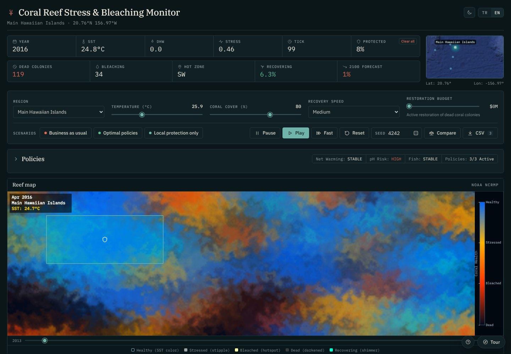
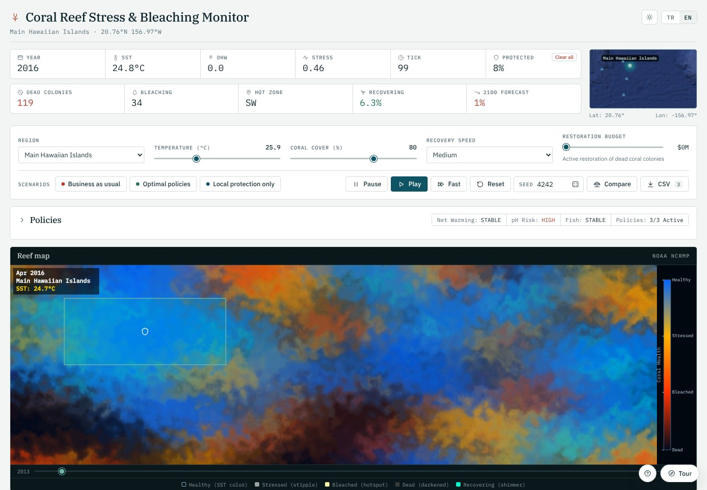
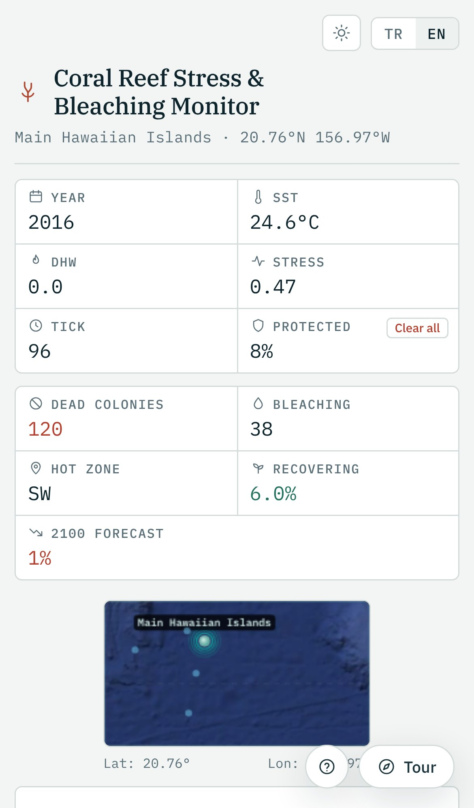
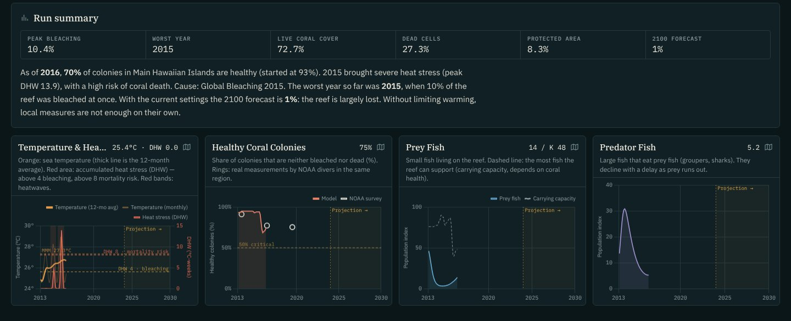
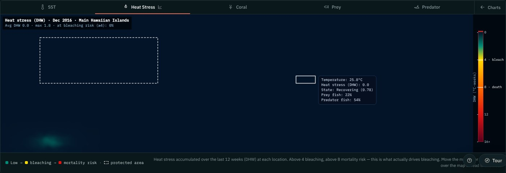

# Coral Reef Stress & Bleaching Monitor

**English** · [Türkçe](README.tr.md)

An interactive, browser-based simulation of how Pacific coral reefs respond to marine heatwaves, emissions policy and
local protection. It starts from NOAA reef survey data (2013–2023) and projects each reef to 2100 under the IPCC
SSP2-4.5 scenario.

**Live demo:** https://tugbatuanakaygisiz-web.github.io/coral_simulation/



## Highlights

- **Heat stress the way NOAA measures it.** Each of the 432 reef cells accumulates Degree Heating Weeks (DHW) over a
  rolling 12-week window, using the NOAA Coral Reef Watch definition. Bleaching follows sustained heat, not single hot days.
- **Checked against real surveys.** The share of healthy colonies tracks NOAA NCRMP measurements for five U.S. Pacific
  regions. Calibrating regional climate and documented heatwaves brought the error down from 13.0 to 5.2 percentage points (see [Validation](#validation)).
- **Policy experiments.** Emission sources, ocean policies, a restoration budget and marine protected areas that you
  draw on the map all feed into the model. Three preset scenarios and a side-by-side comparison mode make the trade-offs visible.
- **Reproducible runs.** All randomness comes from a seeded generator. `?seed=4242` in the URL reproduces a run
  exactly, and the CSV export records the seed with every row.
- **Built to be read.** Four synchronised charts with NOAA reference points, DHW and stress heatmaps, and a short written
  summary updated once per simulated year. There is also an end-of-run assessment.
- **Polished front end.** Light and dark themes, a full Turkish/English switch, a mobile layout, keyboard-accessible
  controls and WCAG AA text contrast. The reef map renders at about 60 fps.

| Light theme | Mobile |
|---|---|
|  |  |

| Charts | DHW heatmap |
|---|---|
|  |  |

## How the model works

One tick is about 12 days, so 30 ticks make a year. A full run covers 2013–2100.

1. **Sea surface temperature.** Each region has its own mean SST, seasonal amplitude, warmest month and Maximum
   Monthly Mean (MMM). Spatial variation comes from simplex noise and three ocean-current centres. Observed regional
   heatwaves (2013–2024) are added at the right time of year; after 2024, seeded El Niño-like events occur about every five years.
2. **Degree Heating Weeks.** `HotSpot = SST − MMM`. Only HotSpots of at least 1 °C are summed over the last 12 weeks.
   Bleaching starts around 4 DHW, and severe bleaching and mortality occur at 8 DHW and above.
3. **Coral stress.** Stress rises with DHW above the bleaching threshold and spreads from bleached neighbours (less so
   inside protected areas). Live colonies recover within months once DHW falls below 1. Dead reef only recovers through
   larval settlement from healthy neighbours, which takes 10–15 years.
4. **Fish.** Prey and predator populations follow Lotka–Volterra dynamics, with a carrying capacity tied to coral health.
5. **Climate projection.** After 2024, warming follows SSP2-4.5 anchors (+0.8 °C by 2050, +1.75 °C by 2100). Emission
   policies phase in gradually between 2024 and 2060 to reflect climate lag.

## Validation

The table compares simulated and NOAA NCRMP healthy-colony percentages for 2013–2023, as RMSE in percentage points,
averaged over six seeds:

| Region | Before calibration | After |
|---|---:|---:|
| American Samoa | 15.9 | 4.6 |
| Main Hawaiian Islands | 2.6 | 4.5 |
| Mariana Archipelago | 12.2 | 2.0 |
| Northwestern Hawaiian Islands | 8.1 | 8.8 |
| Pacific Remote Island Areas | 17.3 | 3.0 |
| **All regions** | **13.0** | **5.2** |

Most of the remaining gap in the Northwestern Hawaiian Islands comes from survey timing: the model assumes each
survey was taken in mid-year.

## Tech stack

- Vanilla JavaScript, HTML5 Canvas and CSS custom properties. No framework and no build step.
- [Chart.js](https://www.chartjs.org/) for the time-series charts.
- IBM Plex Serif, Sans and Mono typefaces. All icons are inline SVG.
- A small i18n layer (`i18n.js`) where every string is stored as a `key: [Turkish, English]` pair.

Notable implementation details:

- The reef map is only recomputed when the simulation advances, at most every 80 ms. Inverse-distance weights come from a
  lookup table. Together these brought frame time from about 67 ms to about 17 ms.
- Theme colours are design tokens on `:root`. Charts re-read them when the theme changes.
- Each purpose has its own seeded random stream (mulberry32). Turning on comparison mode mid-run does not change the main reef's future.

## Running locally

Clone the repository and serve the folder with any static file server, for example:

```bash
python3 -m http.server 8000
# open http://localhost:8000
```

Opening `index.html` directly also works. Some browsers block the mini-map background image under `file://`.

Useful URL parameters: `?seed=1234` (reproducible run) and `?lang=en` / `?lang=tr`.

## Data sources

- **NOAA NCRMP**: National Coral Reef Monitoring Program, about 269,000 adult coral colony observations (2013–2023).
  The regional summary used here is in [`coral_simulation_dataset.csv`](coral_simulation_dataset.csv).
- **NOAA NCEI Global Coral Bleaching Database** (accession 0228498): 35,991 bleaching records, 1963–2012.
- **NOAA Coral Reef Watch**: DHW methodology and 5 km virtual-station climatology.
- **IPCC AR6 SSP2-4.5**: warming pathway for the 2024–2100 projection.

## Limitations

This is an educational model, not a forecasting tool. Climatology values and heatwave intensities are approximations
calibrated to the survey data. The grid is a stylised reef rather than real bathymetry. Policy effects are qualitative
and show direction and relative size, not exact outcomes.

## Project structure

```
index.html                   simulation, UI and styles
i18n.js                      Turkish/English strings and language switching
coral_simulation_dataset.csv NOAA NCRMP regional summary (5 regions)
pacific_map_bg.png           mini-map background
docs/                        screenshots and social preview image
PROJECT_DOCUMENTATION.md     detailed design notes (Turkish)
```

## License

Developed for educational purposes. NOAA data is used under NOAA's open data policy.
